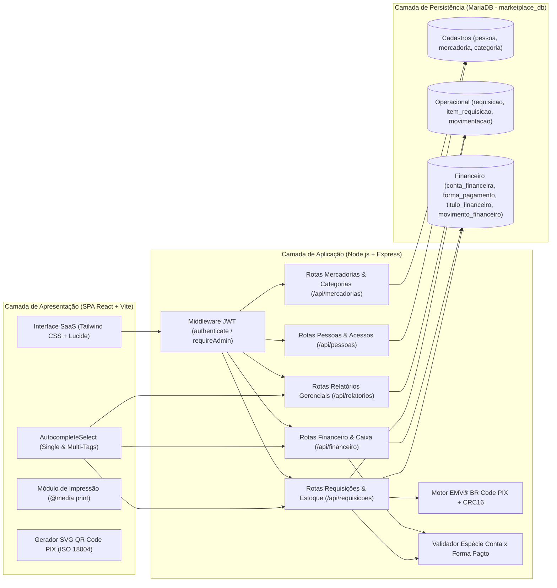
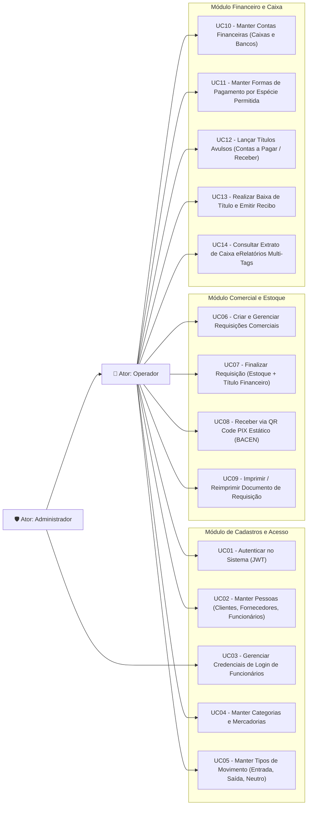
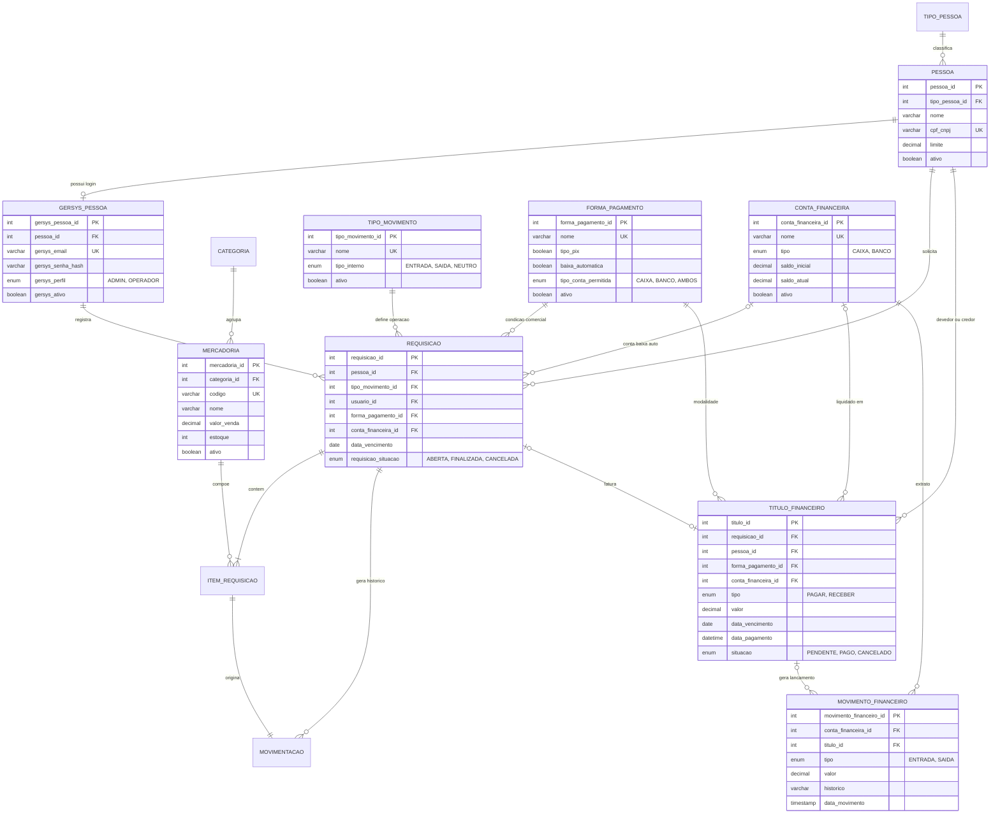
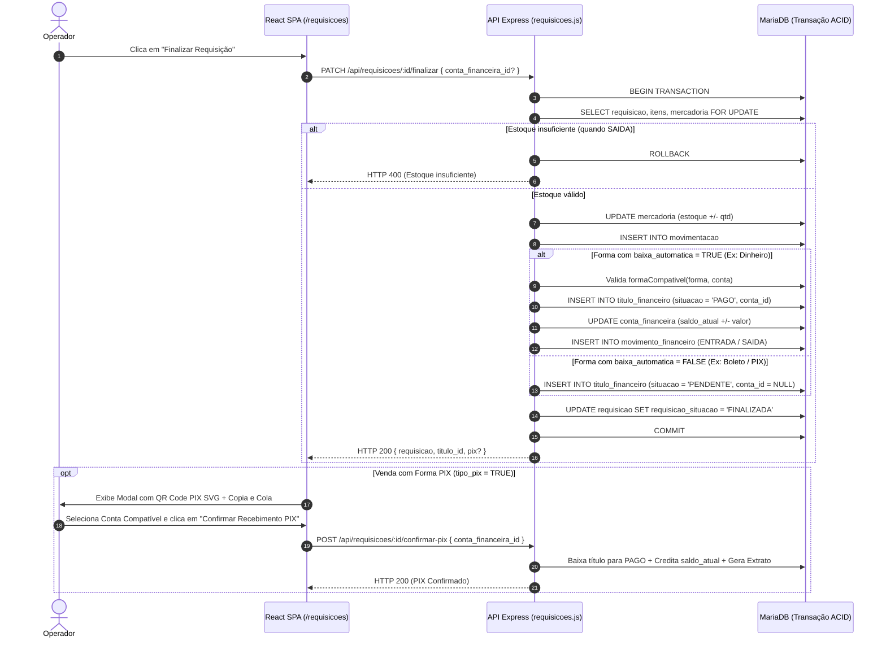
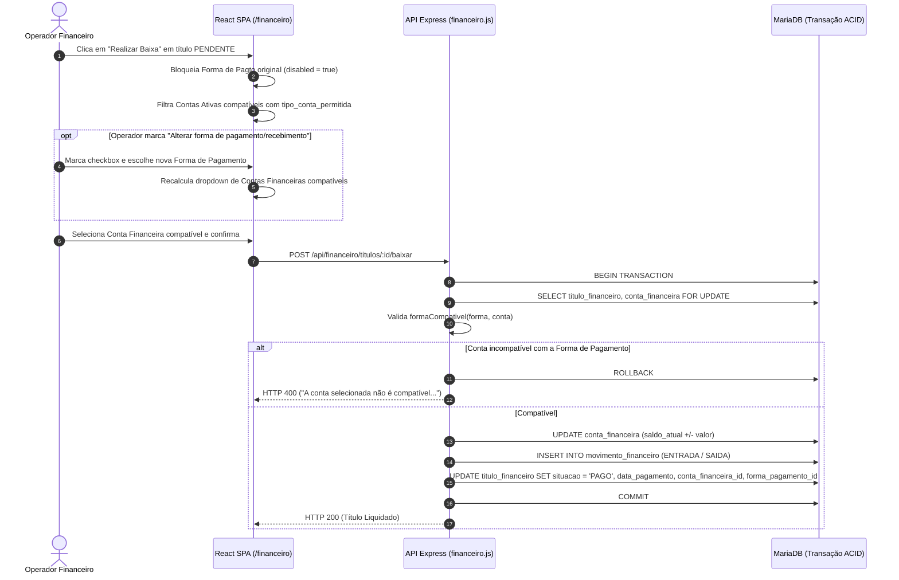
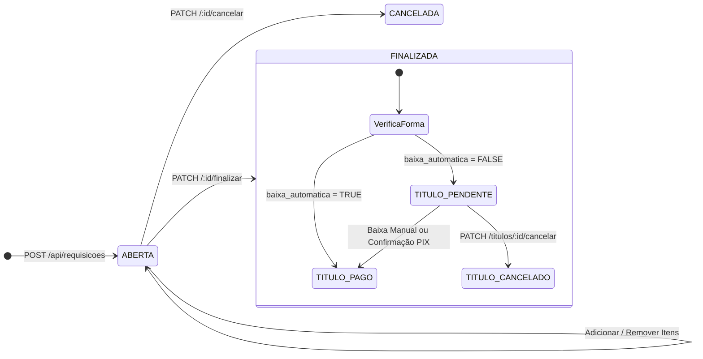

# Documentação Técnica e Funcional — Sistema ReqFlow

O **ReqFlow** é um sistema integrado de **Gestão Comercial, Controle de Estoque e Fluxo Financeiro (ERP/SaaS)** construído em arquitetura cliente-servidor moderna, com interface **Single Page Application (SPA) em React + Tailwind CSS** e back-end **Node.js + Express + MariaDB** operando com transações atômicas (`ACID`) e bloqueio pessimista (`SELECT ... FOR UPDATE`).

---

## 1. Visão Geral da Arquitetura

### Stack Tecnológica
| Camada | Tecnologia | Papel no Sistema |
| :--- | :--- | :--- |
| **Front-end** | React 18 + Vite 5 + React Router 6 | SPA reativa com navegação instantânea e rotas protegidas |
| **Estilização** | Tailwind CSS 3 + Lucide React | Design System SaaS, badges semânticos e layout responsivo/impressão |
| **Back-end** | Node.js + Express | API RESTful com autenticação stateless via JSON Web Token (`JWT`) |
| **Segurança** | `bcryptjs` + `jsonwebtoken` | Hash de senhas com salt e controle de perfil (`ADMIN` e `OPERADOR`) |
| **Banco de Dados** | MariaDB (`InnoDB`, `utf8mb4`) | Integridade referencial, `CHECK` constraints e bloqueio `FOR UPDATE` |

---

## 2. Diagrama de Casos de Uso

O diagrama abaixo representa as interações dos atores (**Operador Comercial/Financeiro** e **Administrador**) com os módulos do **ReqFlow**:

---

## 3. Especificação Detalhada dos Casos de Uso

### UC01 — Autenticar no Sistema
- **Ator Principal:** Operador / Administrador.
- **Pré-condições:** Usuário deve possuir registro ativo em `gersys_pessoa` vinculado a um funcionário em `pessoa`.
- **Fluxo Principal:**
  1. O usuário informa `email` e `senha` na tela `/login`.
  2. O sistema valida o hash da senha com `bcrypt.compare` e verifica `gersys_ativo = TRUE`.
  3. O sistema emite um token JWT assinado contendo `{ id, pessoa_id, email, perfil, nome }` e redireciona para `/dashboard`.

### UC02 & UC03 — Gestão de Pessoas e Credenciais de Funcionários
- **Ator Principal:** Operador (UC02) e Administrador (UC03).
- **Regras de Negócio:**
  - Toda pessoa pertence a um tipo (`CLIENTE`, `FORNECEDOR` ou `FUNCIONARIO`).
  - O campo `cpf_cnpj` é único na base.
  - Exclusões realizam *soft delete* (`ativo = FALSE`) para preservar o histórico fiscal/financeiro.
  - Apenas registros do tipo `FUNCIONARIO` podem receber credenciais de acesso (`ADMIN` ou `OPERADOR`) na tabela `gersys_pessoa`.

### UC04 & UC05 — Gestão de Mercadorias, Categorias e Tipos de Movimento
- **Ator Principal:** Operador.
- **Regras de Negócio:**
  - Mercadorias possuem controle estrito de `estoque >= 0` e alertas visuais no Dashboard quando `estoque <= 5`.
  - Tipos de Movimento determinam o comportamento operacional e financeiro na finalização da requisição:
    - `SAIDA`: reduz estoque da mercadoria e gera título `RECEBER`.
    - `ENTRADA`: incrementa estoque da mercadoria e gera título `PAGAR`.
    - `NEUTRO`: registra movimentação histórica sem alterar saldo físico nem gerar título financeiro.

### UC06 & UC07 — Criar e Finalizar Requisição Comercial
- **Ator Principal:** Operador.
- **Pré-condições:** Pessoa, Tipo de Movimento, Forma de Pagamento e Mercadorias devem estar ativos.
- **Fluxo Principal (Criação):**
  1. O operador seleciona o Cliente/Fornecedor via `AutocompleteSelect` (busca a partir de 2 caracteres), o Tipo de Movimento, a Forma de Pagamento e a Data de Vencimento.
  2. **Regra Condicional de Baixa Automática:**
     - Se a Forma de Pagamento possuir `baixa_automatica = FALSE` (a prazo), o campo **Conta Financeira** permanece oculto.
     - Se a Forma de Pagamento possuir `baixa_automatica = TRUE` (à vista, ex: *Dinheiro*), o sistema exibe e exige o campo **Conta Financeira para Baixa**, filtrando apenas as contas ativas compatíveis com `tipo_conta_permitida` (`CAIXA`, `BANCO` ou `AMBOS`).
  3. A requisição nasce com situação `ABERTA`, permitindo adicionar ou remover itens (`item_requisicao`).
- **Fluxo Principal (Finalização Transacional):**
  1. O operador aciona **Finalizar Requisição** (`PATCH /api/requisicoes/:id/finalizar`).
  2. O sistema inicia uma transação SQL (`BEGIN`) e aplica `SELECT ... FOR UPDATE` na requisição, nos itens e em cada mercadoria.
  3. Para movimentos de `SAIDA`, valida se `mercadoria.estoque >= item.quantidade`. Caso haja saldo insuficiente em qualquer item, executa `ROLLBACK` imediato.
  4. Atualiza o estoque de cada mercadoria e grava o rastro em `movimentacao`.
  5. Calcula o valor líquido total $\sum (\text{quantidade} \times \text{valor} - \text{desconto})$ e gera o título em `titulo_financeiro`:
     - **Quando `baixa_automatica = TRUE`:** O título já nasce com `situacao = 'PAGO'`, `data_pagamento = NOW()` e `conta_financeira_id` preenchido; insere o lançamento em `movimento_financeiro` (`ENTRADA` ou `SAIDA`) e atualiza imediatamente o `saldo_atual` da `conta_financeira`.
     - **Quando `baixa_automatica = FALSE`:** O título nasce com `situacao = 'PENDENTE'` e `conta_financeira_id = NULL` para liquidação futura no Financeiro.
  6. Caso seja uma venda (`SAIDA`) com modalidade `tipo_pix = TRUE`, retorna o payload EMV® BR Code oficial do Banco Central (chave `19983354118`, recebedor `ReqFlow`, cidade `Americana`, CRC16-CCITT) e abre o modal de QR Code PIX.

### UC11 & UC13 — Regras de Espécie de Conta e Baixa de Títulos Financeiros
- **Ator Principal:** Operador Financeiro.
- **Regras de Negócio:**
  - Cada `forma_pagamento` define `tipo_conta_permitida ENUM('CAIXA', 'BANCO', 'AMBOS')`.
  - No modal **Realizar Baixa** (`/financeiro`):
    1. A **Forma de Pagamento** original do título vem pré-selecionada e bloqueada (`disabled`) por padrão.
    2. O seletor de **Conta Financeira** exibe exclusivamente as contas ativas compatíveis com a espécie permitida pela forma do título (ex: *Dinheiro* lista apenas `CAIXA`; *Boleto* lista apenas `BANCO`; *PIX/Cartão* lista `AMBOS`).
    3. Caso o operador marque o checkbox **"Alterar forma de pagamento/recebimento"**, o seletor de forma de pagamento é desbloqueado e a lista de contas financeiras se adapta dinamicamente à nova forma escolhida.
    4. Após a baixa, o operador pode emitir o **Recibo de Pagamento / Recebimento** formatado para impressão (`@media print`).

---

## 4. Diagrama Entidade-Relacionamento (DER)

---

## 5. Diagramas de Sequência dos Fluxos Críticos

### 5.1. Finalização de Requisição (Com Baixa Automática vs. A Prazo / PIX)

### 5.2. Baixa Financeira com Validação de Espécie de Conta

---

## 6. Diagramas de Estados

### Ciclo de Vida da Requisição e do Título Financeiro

---

## 7. Mapa de Endpoints da API REST

| Módulo | Método e Rota | Descrição |
| :--- | :--- | :--- |
| **Autenticação** | `POST /api/auth/login` | Autentica credenciais e retorna token JWT |
| | `GET /api/auth/me` | Retorna dados do usuário autenticado |
| **Pessoas** | `GET /api/pessoas` | Lista clientes, fornecedores e funcionários |
| | `POST / PUT / DELETE /api/pessoas` | Cria, atualiza ou desativa pessoa |
| | `GET / POST / PUT /api/pessoas/:id/login` | Gerencia login de funcionário (`requireAdmin`) |
| **Mercadorias** | `GET / POST / PUT / DELETE /api/categorias` | CRUD de categorias de produtos |
| | `GET / POST / PUT / DELETE /api/mercadorias` | CRUD de mercadorias com filtro de busca e categoria |
| **Tipos de Mov.** | `GET / POST / PUT / DELETE /api/tipos-movimento` | CRUD de tipos (`ENTRADA`, `SAIDA`, `NEUTRO`) |
| | `PATCH /api/tipos-movimento/:id/toggle` | Ativa/desativa tipo de movimento |
| **Requisições** | `GET / POST /api/requisicoes` | Lista e cria requisições comerciais |
| | `POST / DELETE /api/requisicoes/:id/itens` | Gerencia itens de requisições `ABERTA` |
| | `PATCH /api/requisicoes/:id/finalizar` | Finaliza requisição, movimenta estoque e gera financeiro |
| | `POST /api/requisicoes/:id/confirmar-pix` | Liquida título PIX imediatamente na conta escolhida |
| | `GET /api/requisicoes/movimentacoes/todas` | Histórico geral de movimentações de estoque |
| **Financeiro** | `GET / POST / PUT /api/financeiro/contas` | CRUD de Contas Financeiras (`CAIXA` e `BANCO`) |
| | `GET / POST / PUT /api/financeiro/formas-pagamento` | CRUD de Formas de Pagamento (`CAIXA`, `BANCO`, `AMBOS`) |
| | `GET / POST /api/financeiro/titulos` | Lista títulos com totalizadores e cria lançamento avulso |
| | `POST /api/financeiro/titulos/:id/baixar` | Liquida título pendente, atualiza saldo e gera extrato |
| | `GET /api/financeiro/extrato` | Consulta extrato consolidado de entradas e saídas |
| **Relatórios** | `GET /api/relatorios/movimentacoes` | Relatório multi-filtro (`pessoa_ids`, `mercadoria_ids`, período) |
