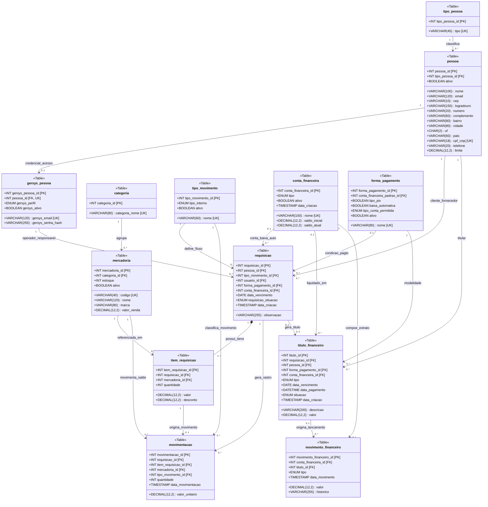
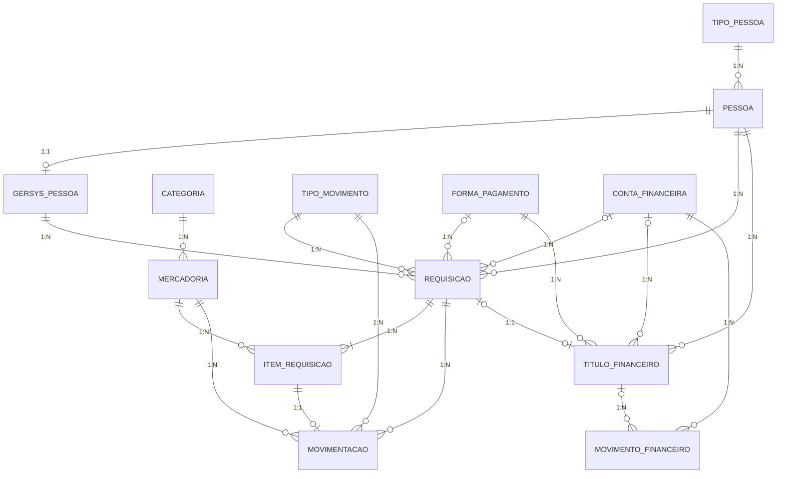

# Modelagem UML do Banco de Dados — ReqFlow (`marketplace_db`)

Este documento apresenta a modelagem completa do banco de dados relacional **`marketplace_db`** (MariaDB / InnoDB) em **notação de Diagrama de Classes UML (`classDiagram`)**, **Diagrama Entidade-Relacionamento (`erDiagram`)** e **Dicionário de Dados Técnico**.

---

## 1. Diagrama de Classes UML do Banco de Dados (`classDiagram`)

O diagrama abaixo representa as **12 tabelas** do banco de dados do **ReqFlow** em formato UML, destacando chaves primárias (`PK`), chaves estrangeiras (`FK`), chaves únicas (`UK`), tipos de dados e multiplicidades (`1`, `0..1`, `0..*`, `1..*`):

---

## 2. Diagrama Entidade-Relacionamento (Notação Pé de Galinha / Crow's Foot)

---

## 3. Dicionário de Dados e Restrições de Integridade

### 3.1. Domínio de Cadastros e Segurança
| Tabela | Chave Primária (`PK`) | Chaves Estrangeiras (`FK`) | Restrições (`UNIQUE` / `CHECK`) |
| :--- | :--- | :--- | :--- |
| **`tipo_pessoa`** | `tipo_pessoa_id` | — | `UK(tipo)` (`CLIENTE`, `FORNECEDOR`, `FUNCIONARIO`) |
| **`pessoa`** | `pessoa_id` | `tipo_pessoa_id -> tipo_pessoa` (`RESTRICT`) | `UK(cpf_cnpj)` |
| **`gersys_pessoa`** | `gersys_pessoa_id` | `pessoa_id -> pessoa` (`RESTRICT`) | `UK(pessoa_id)`, `UK(gersys_email)`, `ENUM('ADMIN','OPERADOR')` |
| **`categoria`** | `categoria_id` | — | `UK(categoria_nome)` |
| **`mercadoria`** | `mercadoria_id` | `categoria_id -> categoria` (`RESTRICT`) | `UK(codigo)`, `CHECK(estoque >= 0)`, `CHECK(valor_venda >= 0)` |

### 3.2. Domínio Operacional (Requisições e Estoque)
| Tabela | Chave Primária (`PK`) | Chaves Estrangeiras (`FK`) | Restrições (`UNIQUE` / `CHECK`) |
| :--- | :--- | :--- | :--- |
| **`tipo_movimento`** | `tipo_movimento_id` | — | `UK(nome)`, `ENUM('ENTRADA','SAIDA','NEUTRO')` |
| **`requisicao`** | `requisicao_id` | `pessoa_id -> pessoa`, `tipo_movimento_id -> tipo_movimento`, `usuario_id -> gersys_pessoa`, `forma_pagamento_id -> forma_pagamento`, `conta_financeira_id -> conta_financeira` | `ENUM('ABERTA','FINALIZADA','CANCELADA')` |
| **`item_requisicao`** | `item_requisicao_id` | `requisicao_id -> requisicao` (`RESTRICT`), `mercadoria_id -> mercadoria` (`RESTRICT`) | `CHECK(quantidade > 0)`, `CHECK(desconto >= 0)` |
| **`movimentacao`** | `movimentacao_id` | `requisicao_id -> requisicao`, `item_requisicao_id -> item_requisicao`, `mercadoria_id -> mercadoria`, `tipo_movimento_id -> tipo_movimento` | `CHECK(quantidade > 0)` |

### 3.3. Domínio Financeiro e Fluxo de Caixa
| Tabela | Chave Primária (`PK`) | Chaves Estrangeiras (`FK`) | Restrições (`UNIQUE` / `CHECK`) |
| :--- | :--- | :--- | :--- |
| **`conta_financeira`** | `conta_financeira_id` | — | `UK(nome)`, `ENUM('CAIXA','BANCO')` |
| **`forma_pagamento`** | `forma_pagamento_id` | `conta_financeira_padrao_id -> conta_financeira` (`SET NULL`) | `UK(nome)`, `tipo_conta_permitida ENUM('CAIXA','BANCO','AMBOS')` |
| **`titulo_financeiro`** | `titulo_id` | `requisicao_id -> requisicao` (`SET NULL`), `pessoa_id -> pessoa` (`RESTRICT`), `forma_pagamento_id -> forma_pagamento` (`RESTRICT`), `conta_financeira_id -> conta_financeira` (`RESTRICT`) | `tipo ENUM('PAGAR','RECEBER')`, `situacao ENUM('PENDENTE','PAGO','CANCELADO')` |
| **`movimento_financeiro`** | `movimento_financeiro_id` | `conta_financeira_id -> conta_financeira` (`RESTRICT`), `titulo_id -> titulo_financeiro` (`SET NULL`) | `tipo ENUM('ENTRADA','SAIDA')` |
